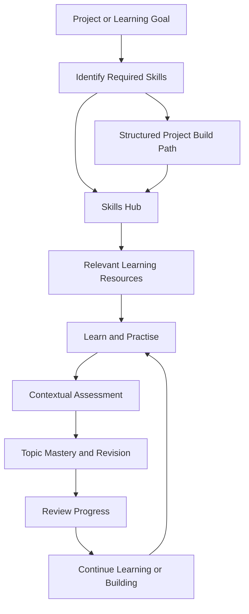
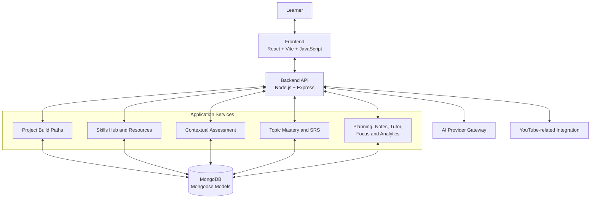
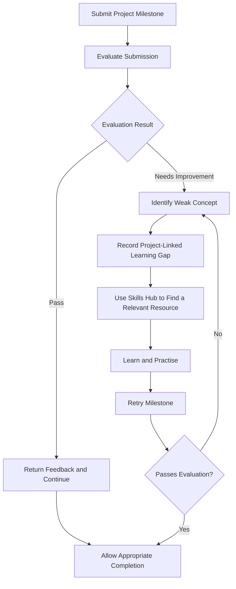

# EduVerse — From Project Goals to Engineering Skills

<p align="center">
  <strong>A project-first, AI-assisted learning platform</strong>
  <br />
  Connecting what learners want to build with the skills, learning resources, and practice needed to get there.
</p>

<p align="center">
  <a href="https://hackyard.org/build2026">Hackyard Build 2026</a> ·
  <a href="https://hackyard.org/build2026/rules">Official Rules</a> ·
  <a href="https://hackyard.org/build2026/guide">Builder Guide</a>
</p>

<p align="center">
  
  
  
  
</p>

---

## Table of Contents

- [Overview](#overview)
- [The Problem](#the-problem)
- [Our Approach](#our-approach)
- [How EduVerse Works](#how-eduverse-works)
- [Core Engines](#core-engines)
- [Feature Overview](#feature-overview)
- [System Architecture](#system-architecture)
- [Hackyard Build Focus](#hackyard-build-focus)
- [Technology Stack](#technology-stack)
- [Demo Walkthrough](#demo-walkthrough)
- [Project Structure](#project-structure)
- [Getting Started](#getting-started)
- [Testing and Verification](#testing-and-verification)
- [Build Roadmap](#build-roadmap)
- [Team](#team)
- [Event References](#event-references)

---

## Overview

**EduVerse** is an AI-assisted learning platform designed to help students move from a learning goal to practical engineering skills through structured learning paths, contextual assessments, and progress tracking.

Learning to build software often requires moving between project roadmaps, documentation, video tutorials, quizzes, notes, revision tools, and progress trackers. EduVerse brings key parts of that journey into one learning environment.

Its central idea is simple:

> Start with what you want to build. Discover what you need to learn. Practise those skills. Measure your understanding. Use that information to decide what to do next.

At Hackyard Build 2026, Team TGW is focusing on a project-centred improvement: connecting project-milestone evaluation with targeted learning recommendations and a guided retry workflow.

**Event:** Hackyard Build 2026  
**Venue:** Indian Institute of Technology Guwahati  
**Dates:** 24–25 October 2026  
**Team:** TGW — The Great Warriors

## The Problem

A learner can have a clear project idea and still struggle to turn it into a realistic learning plan.

The difficulty is not always a lack of educational content. Often, learners need help answering practical questions:

- Which skills and prerequisites does my project require?
- Which resource should I use to learn a particular skill?
- Do I understand the concept well enough to apply it?
- What should I do when an assessment or project milestone reveals a gap?
- How can I track progress without losing the connection between learning and building?

When these activities are disconnected, learners must repeatedly decide what to learn, where to find it, and how to check whether they are making progress.

EduVerse approaches learning through the learner's intended outcome: **the project they want to build and the skills required to build it.**

## Our Approach

EduVerse combines project-oriented learning paths with skill discovery, learning resources, contextual assessment, topic mastery, and revision support.

Instead of treating every learning feature as an isolated destination, the platform aims to connect the following stages:

1. **Define a goal** — begin with a project or learning objective.
2. **Identify required skills** — organise the relevant skills, prerequisites, and milestones.
3. **Find learning resources** — use the Skills Hub to discover relevant learning material.
4. **Learn and practise** — work through the selected resources and project milestones.
5. **Assess understanding** — use contextual assessments and task feedback.
6. **Track mastery** — use topic-level progress and spaced revision to support retention.
7. **Choose the next step** — return to learning, revise a weak topic, or continue building.

The Hackyard-focused objective is to strengthen the connection between project evaluation and the learner's next actionable learning step.

## How EduVerse Works

The following diagram represents the intended product-level learning journey. Individual transitions depend on the capability and integration available in the current implementation.



**Where the Skills Hub fits:** it connects identified skills with relevant learning resources. It supports the initial project-learning path and is also the intended destination for targeted resource recommendations when a learner needs to strengthen a weak concept.

---

## Core Engines

EduVerse's three principal engines serve different but complementary roles.

### 1. Project Build Paths Engine

Transforms a project goal into a structured sequence of learning and implementation milestones.

The audited implementation includes canonical input deduplication, layered quality checks, curated documentation-domain validation, and milestone sequencing.

**Purpose:** Help learners approach a project through an ordered path rather than an unstructured collection of tutorials.

### 2. Learning and Contextual Assessment Engine

Connects learning material with assessments intended to check understanding in context.

The audited implementation includes video-range and chapter-context handling, quiz generation, bilingual validation, structural checks, and additional quality evaluation.

**Purpose:** Make learning more active by introducing assessment alongside learning rather than relying exclusively on passive content consumption.

### 3. Topic Mastery and Spaced-Repetition Engine

Stores topic-level learning information and supports revision scheduling.

The audited implementation includes topic mastery data, weak-area tracking, revision-due logic, and an SM-2 spaced-repetition implementation.

**Purpose:** Help learners identify topics that need further attention and organise revision over time.

### Supporting Subsystems

The platform also contains study planning, Skills Hub/resource discovery, Smart Notes, flashcards, AI-assisted tutoring, focus sessions, learning analytics, gamification, notifications, and account-related functionality.

## Feature Overview

The following list summarises the major capabilities identified in the existing EduVerse codebase and audit.

| Area | Capabilities |
|---|---|
| Project-first learning | Project goals, skill paths, structured milestones, and progress tracking |
| Skills and resources | Skills Hub, skill discovery, and learning-resource access |
| Video-based learning | Learning interface, video-related progress handling, and playlist-related functionality |
| Contextual assessment | Video-range/chapter-context quiz generation and assessment validation |
| Mastery and revision | TopicMastery, weak-area tracking, revision scheduling, and spaced repetition |
| Active recall | Flashcard creation and study workflows |
| Study organisation | AI Study Planner and Smart Notes |
| Learning assistance | AI Tutor, contextual chatbot, and peer-tutoring functionality |
| Progress and engagement | Dashboard, analytics, focus sessions, streaks, XP, and notifications |
| Additional utility | Expense Tracker and account/profile functionality |

This table describes the major feature areas; it is not a guarantee that every feature has identical test coverage or depends on the same backend workflow.

## System Architecture

EduVerse follows a decoupled full-stack architecture. The React/Vite frontend communicates with a Node.js/Express API. Backend services apply application logic, persist relevant data through Mongoose models, and use external integrations where required.



### Request Lifecycle

A typical API interaction follows this conceptual sequence:

1. A learner interacts with a frontend page or component.
2. The frontend handler sends an HTTP request through the API layer.
3. Express routes and applicable middleware process the request.
4. Backend route handlers and services apply validation and business logic.
5. Mongoose models read or persist relevant application data.
6. External AI or learning-resource services are called where needed.
7. The backend returns a response.
8. The frontend handles the response and updates the interface.

The exact path varies by endpoint. This diagram represents the architectural pattern, not a claim that every request passes through an identical set of layers.

## Hackyard Build Focus

### Closing the Project Feedback Loop

EduVerse already contains project-oriented Build Paths and a separate topic-mastery and revision system. The inspected milestone-submission flow stores evaluation feedback, but the audit identified a missing connection from failed project submissions to automatic mastery updates and targeted remediation.

The Hackyard-focused objective is to connect these capabilities through a bounded, testable workflow.

### Proposed Workflow

> **Evaluate → Identify the Gap → Recommend → Remediate → Retry**



**Important:** This is the proposed Hackyard contribution, not a claim that the complete loop was already implemented before the event. The final implementation must preserve the semantics of existing quiz and mastery records rather than treating every failed project task as an incorrect quiz answer.

### Intended Outcomes

- Make project feedback more actionable.
- Associate a learning difficulty with an identifiable skill or concept.
- Recommend a relevant resource through the Skills Hub.
- Give learners a clear path from remediation back to project work.
- Apply appropriate evaluation and completion rules.
- Demonstrate the new workflow end to end.

The objective is not to claim that each component is individually novel. It is to build and demonstrate a useful connection between existing learning and project-building capabilities.

### Existing Foundation vs. Hackyard Contribution

| Area | Scope |
|---|---|
| Project Build Paths | Existing EduVerse foundation |
| Skills Hub and resource discovery | Existing EduVerse foundation |
| Topic mastery and spaced repetition | Existing EduVerse foundation |
| Contextual assessment and feedback | Existing EduVerse foundation |
| Project-failure-to-learning-gap connection | Hackyard-focused contribution |
| Targeted resource recommendation from a project gap | Hackyard-focused contribution |
| Remediation-to-retry workflow and related completion rules | Hackyard-focused contribution |

The implementation status of each new capability should be updated only after the corresponding behaviour is implemented and verified in the current repository.

## Technology Stack

### Frontend
- React
- Vite
- JavaScript and JSX
- React Context API for shared application state in identified contexts

### Backend
- Node.js
- Express 5
- JavaScript
- REST APIs

### Database
- MongoDB
- Mongoose ODM

### AI and Learning Integrations
- Backend AI-provider gateway and related orchestration
- YouTube-related learning integration
- Curated documentation/resource links and validation

### Development and Quality Tooling
- Node.js native test runner (`node:test`)
- ESLint
- Git and GitHub

This is the core stack identified in the project audit. Exact third-party AI provider names, package versions, deployment services, and configuration requirements should be confirmed against the current package manifests and environment templates before being documented as definitive dependencies.

## Demo Walkthrough

The demonstration should follow one understandable learner journey rather than jumping between unrelated features.

1. **Start with a project goal.** Show how the project relates to required skills and a structured path.
2. **Open the Skills Hub.** Show how a learner finds resources relevant to a skill.
3. **Show learning and assessment.** Demonstrate a relevant learning resource and the existing contextual assessment workflow.
4. **Show the Hackyard contribution.** Submit a project milestone and demonstrate the new feedback-to-remediation workflow, if implemented and tested.
5. **Retry and verify.** Show what changes after remediation and how the system handles the next attempt.
6. **Close with the value.** Explain how the workflow connects learning decisions with practical project progress.

Use prepared demo data only where appropriate. Do not expose credentials, real student data, or private configuration values.

## Project Structure

The existing EduVerse application is organised into frontend and backend areas. Confirm the actual folders in this event repository before relying on this outline.

```text
EduVerse/
├── frontend/
│   └── src/
│       ├── api.js
│       ├── components/
│       └── pages/
├── backend/
│   ├── routes/
│   ├── services/
│   ├── models/
│   ├── integrations/
│   ├── utils/
│   └── tests/
├── docs/
│   └── audits/
└── README.md
```

Key responsibilities:

- `frontend/src/pages/` — major user-facing page workflows.
- `frontend/src/components/` — reusable UI components.
- `backend/routes/` — HTTP endpoint registration and request handling.
- `backend/services/` — application and domain logic.
- `backend/models/` — Mongoose data models.
- `backend/integrations/` — external-service integration code.
- `backend/tests/` — automated tests.

The presence and exact names of these paths should be checked in the repository's current branch.

## Getting Started

### Prerequisites

- Node.js and npm compatible with the project's current package manifests.
- Access to the repository's configured database and any required external services.
- Environment variables required by the backend and frontend configuration.

### Local Setup

Clone the repository:

```bash
git clone <YOUR-REPOSITORY-URL>
cd <YOUR-REPOSITORY-FOLDER>
```

Install dependencies in the relevant application directories:

```bash
cd backend
npm install
npm run
```

The `npm run` command lists the scripts defined by the backend package. Use the appropriate development script shown by that package.

In a separate terminal:

```bash
cd <YOUR-REPOSITORY-FOLDER>/frontend
npm install
npm run
```

Use the development script declared in the frontend package. The exact script names and environment requirements must be taken from the current repository rather than assumed.

### Environment Configuration

1. Inspect the applicable `.env.example` files.
2. Create local environment files with the values required by the application.
3. Configure database access and external-service credentials as appropriate.
4. Never commit `.env` files, API keys, tokens, or private credentials.

Do not publish production secrets or copy private environment values into documentation.

## Testing and Verification

Run the checks supported by the current repository before presenting or deploying the build.

The following commands were used in the earlier EduVerse audit:

```bash
node --test backend/tests/*.test.js
npm run build --prefix frontend
npm run lint --prefix frontend
```

Re-run these commands in the current branch and inspect their actual output. Previously reported results describe an earlier audit snapshot and should not automatically be presented as current results.

For the Hackyard contribution, the most important tests should cover:

- Passing and failing milestone evaluations.
- Validated structured evaluation output and malformed responses.
- Persistence of project-linked learning gaps.
- Correct mapping from a weak concept to a relevant resource.
- Protection of existing mastery and quiz statistics.
- Repeated submissions and idempotency.
- Authentication and ownership checks.
- Correct retry and milestone-completion behaviour.
- Frontend loading, error, remediation, retry, and success states.
- Compatibility with existing user progress records.

A successful build or passing unit tests do not, by themselves, establish that every production integration works.

## Build Roadmap

The event-focused work should prioritise a complete, demonstrable vertical slice.

### P0 — Core Workflow
- [ ] Define and validate the milestone-evaluation contract.
- [ ] Identify weak concepts from unsuccessful submissions.
- [ ] Persist project-linked learning-gap evidence.
- [ ] Connect the gap to a relevant Skills Hub resource.
- [ ] Add the frontend remediation and retry experience.
- [ ] Apply appropriate milestone-completion rules.
- [ ] Add automated tests for the complete workflow.
- [ ] Rehearse and verify the demo on the intended environment.

### P1 — Enhancements
- [ ] More targeted diagnostic learning activities.
- [ ] Better handling of multiple weak concepts.
- [ ] Richer progress visualisation for remediation outcomes.
- [ ] Broader resource matching and recommendation quality.

Additional features should be considered only after the P0 journey works reliably.

## Team

**Team TGW — The Great Warriors**

- **Kartik Gupta** — Team Lead
- **Saransh Kashyap** — Team Member

Our focus is to use the existing EduVerse foundation to build a meaningful improvement that connects project work with actionable learning.

## Event References

- [Hackyard Build 2026 — Official Overview](https://hackyard.org/build2026)
- [Hackyard Build 2026 — Official Rules](https://hackyard.org/build2026/rules)
- [Hackyard Build 2026 — Builder Guide](https://hackyard.org/build2026/guide)

The official rules permit the use of pre-existing project foundations when disclosed. This README therefore distinguishes the existing EduVerse platform from the event-focused contribution.

---

<p align="center">
  <strong>EduVerse</strong><br />
  Learn with direction. Build with purpose. Improve with feedback.
</p>