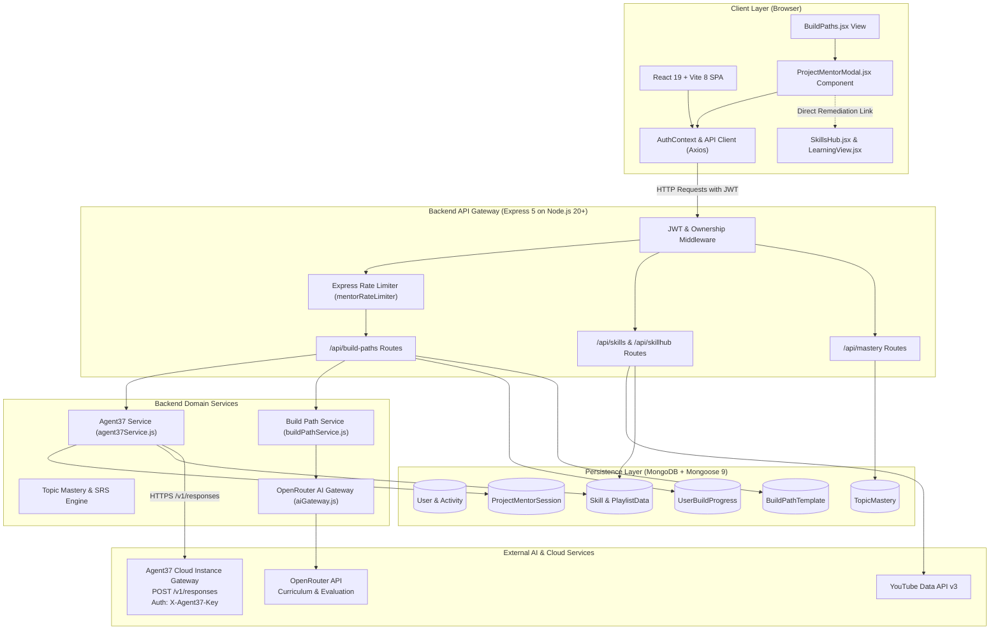
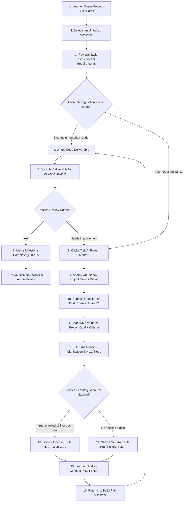

# EduVerse — From Project Goals to Engineering Skills

<p align="center">
  <strong>A project-first, AI-assisted learning platform connecting what learners want to build with the skills, learning resources, and practice needed to get there.</strong>
</p>

<p align="center">
  <a href="https://hackyard.org/build2026">Hackyard Build 2026</a> ·
  <a href="https://hackyard.org/build2026/agent37">Agent37 Challenge</a> ·
  <a href="https://hackyard.org/build2026/rules">Official Rules</a> ·
  <a href="https://hackyard.org/build2026/guide">Builder Guide</a> ·
  <a href="https://www.agent37.com/cloud">Agent37 Cloud</a>
</p>

<p align="center">
  
  
  
  
  
  
</p>

---

## Table of Contents

- [Project Identity](#project-identity)
- [Project Overview](#project-overview)
- [The Problem and Solution](#the-problem-and-solution)
- [Existing Platform Capabilities](#existing-platform-capabilities)
- [Agent37 Integration — AI Project Mentor](#agent37-integration--ai-project-mentor)
- [System Architecture](#system-architecture)
- [Learner Journey Workflow](#learner-journey-workflow)
- [Technology Stack](#technology-stack)
- [Getting Started](#getting-started)
- [Agent37 Configuration](#agent37-configuration)
- [Verification & Testing](#verification--testing)
- [Security & Data Handling](#security--data-handling)
- [Existing Foundation vs. Hackyard Contribution](#existing-foundation-vs-hackyard-contribution)
- [Known Limitations & Roadmap](#known-limitations--roadmap)
- [Team & References](#team--references)

---

## Project Identity

- **Platform:** EduVerse
- **Tagline:** *From Project Goals to Engineering Skills*
- **Event:** [Hackyard Build 2026](https://hackyard.org/build2026) — 24-Hour In-Person Hackathon
- **Venue:** Indian Institute of Technology Guwahati (IIT Guwahati)
- **Dates:** 24–25 October 2026
- **Team:** **Team TGW — The Great Warriors**
  - **Kartik Gupta** — Team Lead
  - **Saransh Kashyap** — Team Member
- **Integration Feature:** **EduVerse AI Project Mentor — Powered by Agent37**

EduVerse is a project-first, AI-assisted learning environment designed to bridge the gap between aspirational project ideas and practical software engineering competencies. Rather than requiring learners to navigate disconnected tutorials, isolated quizzes, external documentation sites, and disparate progress trackers, EduVerse unifies roadmapping, resource discovery, contextual assessment, topic mastery, and AI-powered mentoring.

---

## Project Overview

Learning to build software is most effective when grounded in a concrete goal. However, traditional education often separates theory from execution: students watch hours of video tutorials without building, or jump into complex codebases without understanding core architectural foundations.

EduVerse organizes learning around what the student wants to build:

1. **Define a Project Goal:** A learner specifies what they want to create (e.g., *"Personal Finance Tracker"*, *"Real-Time Chat Application"*, or *"College Management System"*).
2. **Generate a Structured Build Path:** The engine creates an ordered roadmap of practical milestones, each with clear architectural objectives, task instructions, official documentation references, and hands-on deliverables.
3. **Connect to Skills Hub:** Each milestone links to targeted learning material in EduVerse's Skills Hub, allowing learners to acquire prerequisites before or during implementation.
4. **Contextual Evaluation & In-Flow Mentoring:** As learners work on deliverables, they can request automated evaluation and consult the **Agent37 AI Project Mentor** for diagnosis, conceptual clarification, and direct remediation recommendations.
5. **Mastery Tracking & Spaced Repetition:** Concept-level mastery and review schedules are tracked systematically over time using an SM-2 spaced repetition algorithm.

---

## The Problem and Solution

```
┌─────────────────────────────────────────────────────────────┐
│                      THE LEARNING GAP                       │
├──────────────────────────────┬──────────────────────────────┤
│ TRADITIONAL DISCONNECTED FLOW│      EDUVERSE INTEGRATED     │
├──────────────────────────────┼──────────────────────────────┤
│ • Abstract, fragmented video │ • Concrete, project-grounded │
│   playlists without context  │   Build Paths and milestones │
│ • Learners get stuck on code │ • In-flow AI Project Mentor  │
│   errors with no guidance    │   powered by Agent37         │
│ • Failed attempts lead to    │ • Verified remediation links │
│   abandonment & frustration  │   directly into Skills Hub   │
│ • No structured tracking of  │ • Monotonic progress, SM-2   │
│   what concepts were learned │   mastery & spaced revision  │
└──────────────────────────────┴──────────────────────────────┘
```

When learners encounter difficulties during a milestone deliverable, generic chatbots lack awareness of the project goal, tech stack, evaluation criteria, or workspace resources. EduVerse solves this by passing structured, verified project context to an isolated **Agent37 cloud agent instance**, enabling the mentor to offer specific diagnoses and point directly to verified learning resources in EduVerse's **Skills Hub**.

---

## Existing Platform Capabilities

The pre-existing EduVerse codebase provides a comprehensive suite of learning tools verified directly from source:

| Capability Area | Concrete Implementation Details |
|---|---|
| **Project Build Paths** | Intake engine supporting canonical token deduplication, 3-layer structural validation gate, official documentation domain allowlisting, and cached step-by-step implementation walkthroughs. |
| **Skills Hub** | Video and playlist learning tracker with YouTube Data API v3 search, monotonic progress calculations, non-destructive re-syncing, and performance calendar tracking. |
| **Video Learning & Watch-Range Quizzes** | `LearningView` with interactive video playback, timestamp chapter parsing, and watch-range-targeted quiz generation with bilingual quality validation. |
| **Topic Mastery & Spaced Repetition** | `TopicMastery` model with canonical topic deduplication, category tagging, and SuperMemo SM-2 spaced repetition interval calculation. |
| **Smart Notes & Active Recall** | TipTap rich-text editor with auto-save, PDF export, and active-recall flashcard study workflows. |
| **AI Study Planner** | Multi-day progressive roadmap generator enriched with live YouTube tutorials and curated articles. |
| **Peer Tutoring Network** | Community problem-and-solution exchange with XP rewards and additive milestone deliverable review flags. |
| **Focus & Gamification** | Deep work Pomodoro timer sessions, XP leveling system (1,000 XP threshold progression), and daily learning streak tracking. |
| **Account & Security** | JWT cookie-based session management, bcrypt password hashing, Google OAuth server-side verification, Helmet HTTP protection, and MongoDB operator sanitization. |

---

## Agent37 Integration — AI Project Mentor

### Why Agent37 for EduVerse?

During Hackyard Build 2026, Team TGW integrated **Agent37** (`https://www.agent37.com/cloud`) as the dedicated intelligence layer for milestone mentoring.

Agent37 provides isolated, persistent AI agent environments designed for complex, multi-turn interactions. In EduVerse, the mentor serves as an **AI Project Mentor embedded directly inside the Project Build Paths milestone workflow**.

```
Project Build Paths ──► Select Milestone ──► Ask AI Project Mentor
                              │                         │
                              ▼                         ▼
                      Retry Milestone  ◄─── Open Skills Hub Resource
```

### Key Integration Highlights

1. **Context-Aware Prompts:** When a learner opens the mentor, EduVerse's backend gathers:
   - Project idea, tech stack, and skill level.
   - Milestone index, title, description, and task instructions.
   - Hands-on evaluation criteria.
   - Learner's draft code or previous submission deliverable.
   - Prior evaluation feedback (if any).
   - Candidate learning resources available in the user's workspace (enrolled Skills Hub courses and verified documentation links).
2. **Documented Messaging API Protocol:**
   - **Endpoint:** `POST https://<instance-id>.agent37.app/v1/responses`
   - **Authentication:** `X-Agent37-Key: <sk_live_...>` header.
   - **Payload:** `{ "input": "...", "session_id": "...", "stream": false }`
   - **Response:** `{ "status": "completed", "output_text": "...", "session_id": "..." }`
3. **Scoped Session Persistence:**
   - Conversations are isolated in MongoDB via `ProjectMentorSession`.
   - Each session is strictly bound to `(userId, progressId, moduleIndex)`.
   - The returned Agent37 `session_id` is persisted so follow-up questions preserve multi-turn context without client tampering.
4. **Skills Hub Remediation Linkage:**
   - The mentor's response is matched against candidate application resources.
   - If a matching course or documentation page is identified, the UI renders an actionable **Recommended Next Learning Step** card with a direct link to `/skills/:id/learn`.
   - Fallback destinations safely point learners to the Skills Hub (`/skills`) rather than generating unverified URLs.
5. **Strict Application Security:**
   - Agent37 credentials reside exclusively on the backend (`process.env.AGENT37_API_KEY`).
   - All errors are sanitized to redact API keys and bearer tokens.
   - Rate limiting (40 requests per 15 minutes) prevents runaway API usage.
   - Model text cannot authoritatively complete milestones or award XP.

---

## System Architecture

The following diagram illustrates the verified full-stack architecture of EduVerse, including backend services, MongoDB collections, and the Agent37 Cloud integration:



---

## Learner Journey Workflow

The following diagram illustrates the learner's journey when tackling a project milestone, requesting guidance from the AI Project Mentor, exploring remediation material, and completing the milestone:



---

## Technology Stack

The technology stack is verified directly against repository package manifests:

### Frontend (`frontend/package.json`)
- **Core Framework:** React 19 (`react` 19.2.4, `react-dom` 19.2.4)
- **Build Tooling:** Vite 8 (`vite` 8.0.10) with `@vitejs/plugin-react`
- **Routing:** React Router DOM v7 (`react-router-dom` 7.13.2)
- **Styling:** Tailwind CSS 3.4 (`tailwindcss`, `postcss`, `autoprefixer`)
- **Animation:** Framer Motion 12 (`framer-motion` 12.38.0)
- **Icons:** Lucide React (`lucide-react` 1.7.0)
- **Rich Text Editing:** TipTap Editor 3 (`@tiptap/react`, `@tiptap/starter-kit`)
- **HTTP Client:** Axios (`axios` 1.14.0) with central interceptors
- **Notifications:** React Hot Toast (`react-hot-toast` 2.6.0)

### Backend (`backend/package.json`)
- **Runtime:** Node.js (v20.0.0+)
- **Web Framework:** Express 5 (`express` 5.2.1)
- **Database & ODM:** MongoDB with Mongoose 9 (`mongoose` 9.3.3)
- **Security & Middleware:**
  - `helmet` 8.1.0 for HTTP headers
  - `express-rate-limit` 8.4.1 for endpoint throttling
  - `cookie-parser` 1.4.7 for HttpOnly authentication cookies
  - Custom in-place recursive MongoDB operator sanitization
  - `jsonwebtoken` 9.0.3 and `bcrypt` 6.0.0
- **Integrations:**
  - **Agent37 Cloud API:** Direct HTTP messaging integration (`POST /v1/responses`)
  - **OpenRouter / OpenAI:** LLM generation gateway (`@openrouter/sdk`, `openai`)
  - **YouTube Data API:** YouTube search and playlist processing (`yt-search`, `ytpl`, Axios)
  - **Email Notifications:** Brevo HTTP API

### Development & Quality Tooling
- **Test Runner:** Node.js native test runner (`node:test`, `node:assert/strict`)
- **Linter:** ESLint 9 (`eslint`, `@eslint/js`, `eslint-plugin-react-hooks`)

---

## Getting Started

### Prerequisites
- **Node.js:** v20.0.0 or higher
- **npm:** v10.0.0 or higher
- **MongoDB:** Local instance or MongoDB Atlas connection string

### 1. Clone Repository & Install Dependencies

```bash
# Clone the repository
git clone https://github.com/KartikGupta2005/EduVerse-Hackyard.git
cd EduVerse-Hackyard

# Install dependencies for both backend and frontend
npm run install-all
```

Alternatively, install in each folder individually:
```bash
cd backend && npm install
cd ../frontend && npm install
cd ..
```

### 2. Environment Configuration

1. Copy the backend template:
   ```bash
   cp backend/.env.example backend/.env
   ```
2. Configure database credentials, JWT secret, and API keys inside `backend/.env`.
3. Copy the frontend template:
   ```bash
   cp frontend/.env.example frontend/.env
   ```
4. Verify `VITE_API_BASE_URL` points to your backend (default: `http://localhost:5000/api`).

> [!IMPORTANT]
> Never commit `.env` files or expose API credentials in public repositories. Backend secrets must never be prefixed with `VITE_`.

### 3. Running Development Servers

Start the backend (Terminal 1):
```bash
npm run dev:backend
# Server runs on http://localhost:5000
```

Start the frontend (Terminal 2):
```bash
npm run dev:frontend
# Vite development server runs on http://localhost:5173
```

---

## Agent37 Configuration

The AI Project Mentor connects to Agent37 cloud agent instances configured via backend environment variables.

### Environment Variable Reference

| Variable | Type | Default | Description |
|---|---|---|---|
| `AGENT37_ENABLED` | Boolean | `false` | Master feature flag. Set to `true` to enable the mentor. |
| `AGENT37_API_KEY` | String | `""` | Secret data-plane API key (`sk_live_...`) from Agent37. |
| `AGENT37_INSTANCE_ID` | String | `""` | Agent instance ID from your Agent37 dashboard. |
| `AGENT37_INSTANCE_URL` | String | `""` | Optional custom gateway URL (e.g., `https://<id>.agent37.app`). |

### Configuration Example

Add the following to `backend/.env`:

```dotenv
# Enable the AI Project Mentor
AGENT37_ENABLED=true

# Agent37 API Key (never share or commit)
AGENT37_API_KEY=sk_live_your_actual_agent37_key

# Instance Identifier (from https://www.agent37.com/cloud)
AGENT37_INSTANCE_ID=your_instance_identifier_here

# Alternatively, set full URL:
AGENT37_INSTANCE_URL=https://your-instance-id.agent37.app
```

> [!TIP]
> If `AGENT37_INSTANCE_URL` is omitted, the service automatically derives `https://${AGENT37_INSTANCE_ID}.agent37.app/v1/responses`. Both custom URLs and standard instance IDs are supported.

---

## Verification & Testing

### 1. Automated Test Suite Execution

Run all backend test suites using Node.js's native test runner:

```bash
node --test backend/tests/*.test.js
```

**Verified Test Results:**
- **Total Tests:** 112 passing, 0 failing across 48 test suites.
- **Agent37 Mentor Suite:** 28 passing tests covering:
  - Flag validation and missing credential rejection.
  - Endpoint resolution and URL trailing-slash normalization.
  - Secret sanitization and redaction (`sk_live_...`, Bearer tokens).
  - Bounded prompt generation with untrusted input containment.
  - Documented response parsing (`output_text`, `session_id`, status handling).
  - Mock API messaging with header and payload verification.
  - Non-2xx HTTP errors (401, 404, 409 session busy, 429 rate limit, timeouts).
  - Verified Skills Hub resource matching.

### 2. Frontend Production Build & Linting

```bash
# Verify frontend production build:
npm run build --prefix frontend
# Output: ✓ built in 1.36s (3,488 modules transformed, zero compilation errors)

# Verify newly created mentor component:
npx eslint frontend/src/components/buildPaths/ProjectMentorModal.jsx
# Output: 0 errors, 0 warnings
```

### 3. Live Agent37 Verification Procedure

1. **Verify Setup State:**
   - With `AGENT37_ENABLED=false`, open any Project Build Path milestone and click **Ask AI Project Mentor**.
   - Observe the clean amber configuration banner detailing the required setup instructions.
2. **Configure Live Instance:**
   - Set `AGENT37_ENABLED=true`, `AGENT37_API_KEY`, and `AGENT37_INSTANCE_ID` in `backend/.env`.
   - Restart the backend server.
3. **Execute Live Mentor Query:**
   - Reopen the milestone and click **Ask AI Project Mentor**.
   - Enter a query: *"How do I structure Mongoose validation for user registration?"*
   - Observe the returned architectural guidance, diagnostic tips, and the **Recommended Next Learning Step** card linking to the Skills Hub.
4. **Follow Remediation:**
   - Click "Open in Skills Hub" to explore the recommended course or doc link.
   - Return to the milestone, update the code deliverable, and retry submission.

> [!NOTE]
> In environments where live Agent37 instance credentials have not been configured, the integration is verified via automated mock tests and graceful UI fallback, and marked as **BLOCKED — CONFIGURATION REQUIRED** until live credentials are provided.

---

## Security & Data Handling

EduVerse adheres to strict application security principles:

1. **Backend-Only Credentials:** `AGENT37_API_KEY` is loaded only on the server. No client bundle or network response exposes this key.
2. **Authorization & Ownership Enforcement:**
   - Every request to `/api/build-paths/progress/:id/modules/:moduleIndex/mentor` requires a valid JWT token.
   - The route strictly verifies `progress.userId.toString() === req.user.id`. Requests attempting to access another user's progress are rejected with `403 Forbidden`.
3. **Session Privacy:**
   - `ProjectMentorSession` documents are indexed by `{ userId: 1, progressId: 1, moduleIndex: 1 }`.
   - Learners cannot inspect, manipulate, or attach to another user's Agent37 session.
4. **Untrusted Input Handling:**
   - Student prompts are bounded to 2,000 characters.
   - Submitted draft code is bounded to 3,000 characters.
   - System prompts instruct the agent to treat learner input as untrusted.
5. **Secret Redaction:**
   - An error-sanitizing wrapper strips API keys, `X-Agent37-Key` values, and `Bearer` tokens from all error messages before logging or returning to clients.
6. **Separation of Concerns:**
   - The AI Project Mentor is strictly advisory. It cannot alter milestone completion statuses, award XP, or update TopicMastery records directly. Authoritative assessment remains governed by EduVerse's evaluation logic.

---

## Existing Foundation vs. Hackyard Contribution

In accordance with Hackyard Build 2026 rules, the following table distinguishes the pre-existing EduVerse foundation from the contributions implemented during the hackathon:

| Functional Area | Scope | Details |
|---|---|---|
| **Project Build Paths Roadmaps** | Existing Foundation | Project intake, 3-layer curriculum generator, template caching, step-by-step guides. |
| **Skills Hub Video Tracker** | Existing Foundation | YouTube playlist and video tracking, monotonic progress calculation, auto-sync. |
| **Topic Mastery & SRS Engine** | Existing Foundation | SuperMemo SM-2 algorithm, weak-topic tracking, revision due scheduling. |
| **Contextual Quizzes** | Existing Foundation | Watch-range quiz generation, bilingual validation, quiz scoring. |
| **Gamification & XP** | Existing Foundation | Centralized XP progression, streak tracking, activity logging. |
| **AI Project Mentor Integration** | **Hackyard Contribution** | **Complete integration with Agent37 cloud agent instances via documented messaging API.** |
| **In-Flow Milestone Mentoring UI** | **Hackyard Contribution** | **Contextual modal dialog (`ProjectMentorModal.jsx`) embedded in milestone workflows.** |
| **Milestone-to-Skills-Hub Linkage** | **Hackyard Contribution** | **Automated matching of verified application resources to provide actionable next learning steps.** |
| **Mentor Session Persistence** | **Hackyard Contribution** | **Scoped `ProjectMentorSession` schema isolating multi-turn conversations per milestone.** |
| **Agent37 Test Suite** | **Hackyard Contribution** | **28 comprehensive automated tests covering configuration, protocol, sanitization, and edge cases.** |
| **Comprehensive Report & Documentation** | **Hackyard Contribution** | **`AGENT37_IMPLEMENTATION_AND_VERIFICATION.md` and overhauled root README.** |

---

## Known Limitations & Roadmap

### Current Limitations
- **Pre-Provisioned Instances:** The integration connects to an existing, pre-provisioned Agent37 cloud instance configured via environment variables. Automatic on-demand provisioning via control plane (`POST /v1/instances`) was intentionally omitted to prevent unexpected compute costs for learners during normal browsing.
- **Non-Streaming Initial Implementation:** The initial integration implements `stream: false` as specified for first-version reliability. Real-time token streaming (SSE) via `response.output_text.delta` is planned for the next release.
- **Catalogue Bounding:** The mentor only recommends resources present in the user's enrolled skills or the milestone's verified doc allowlist.

### Roadmap
- [ ] Add Server-Sent Events (SSE) streaming for real-time token rendering.
- [ ] Support multi-file workspace inspection when Agent37 container tool runtimes are configured.
- [ ] Add interactive diagnostic exercises directly inside the mentor chat drawer.
- [ ] Expand the verified documentation allowlist to support additional emerging frameworks.

---

## Team & References

### Team TGW — The Great Warriors
- **Kartik Gupta** — Team Lead
- **Saransh Kashyap** — Team Member

### Event & Partner References
- [Hackyard Build 2026 Official Site](https://hackyard.org/build2026)
- [Hackyard Agent37 Challenge](https://hackyard.org/build2026/agent37)
- [Hackyard Build 2026 Rules](https://hackyard.org/build2026/rules)
- [Hackyard Builder Guide](https://hackyard.org/build2026/guide)
- [Agent37 Cloud](https://www.agent37.com/cloud)
- [Agent37 Documentation](https://www.agent37.com/docs)
- [Agent37 Quickstart](https://www.agent37.com/docs/quickstart)
- [Agent37 Chat API Reference](https://www.agent37.com/docs/agents-api/chat)
- [Agent37 Pricing](https://www.agent37.com/pricing)

---

<p align="center">
  <strong>EduVerse × Agent37</strong><br />
  Learn with direction. Build with purpose. Improve with feedback.
</p>
