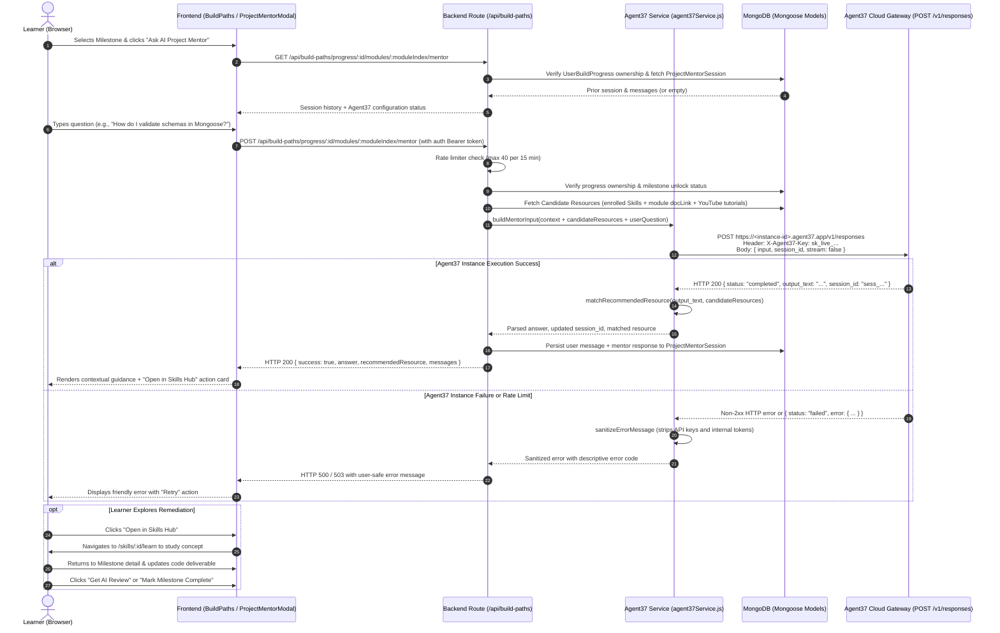

# EduVerse × Agent37 — AI Project Mentor
## Implementation and Verification Report

**Event:** Hackyard Build 2026 | Indian Institute of Technology Guwahati  
**Dates:** 24–25 October 2026  
**Team:** Team TGW (The Great Warriors)  
**Team Lead:** Kartik Gupta  
**Team Member:** Saransh Kashyap  
**Integration Focus:** Agent37-Hosted AI Project Mentor within Project Build Paths  
**Report Date:** 25 October 2026  

---

## 1. Executive Summary

This report documents the genuine, end-to-end integration of **Agent37** as an **AI Project Mentor** within the EduVerse platform for Hackyard Build 2026.

EduVerse is a project-first, AI-assisted learning platform that connects what learners want to build with the skills, learning resources, and practice required to succeed. Prior to this integration, learners working through structured **Project Build Paths** could view milestones, inspect step-by-step implementation guides, and submit code for automated AI evaluation or peer reviews. However, when a learner encountered conceptual difficulty or had their milestone deliverable flagged for improvement, there was no dedicated in-flow mentor to guide them through the blocker and navigate them to a verified remediation resource in the **Skills Hub**.

We implemented the **EduVerse AI Project Mentor**, powered by Agent37:
- Directly embedded inside the existing **Project Build Paths** workflow.
- Context-aware: securely incorporates the project goal, tech stack, milestone requirements, hands-on task instructions, evaluation criteria, learner draft code, and previous submission feedback.
- Documented Agent37 messaging API usage: calls `POST https://<instance-id>.agent37.app/v1/responses` via server-side proxy with the `X-Agent37-Key` authentication header and `stream: false`.
- Verified Skills Hub Linkage: matches candidate resources from the user's enrolled Skills Hub courses and milestone documentation/tutorials to recommend concrete next steps, allowing the learner to study and retry the milestone.
- Zero-leakage application security: credentials are stored exclusively on the backend, rate-limited, ownership-verified, and never exposed to the browser.
- Clean fallback: when Agent37 credentials are not yet configured in an environment, the UI displays a clear configuration banner without repeatedly firing failing network requests.

---

## 2. Exact Files Changed and Created

| File Path | Action | Purpose |
|---|---|---|
| `backend/services/agent37Service.js` | **Created** | Core Agent37 integration service. Handles environment configuration validation, URL normalization, credential sanitization, prompt context construction, documented API invocation, response parsing, and Skills Hub resource matching. |
| `backend/models/ProjectMentorSession.js` | **Created** | Scoped conversation persistence model. Binds mentor chat history and Agent37 `session_id` strictly to the authenticated learner (`userId`), build path progress record (`progressId`), and milestone (`moduleIndex`). |
| `backend/routes/buildPaths.js` | **Modified** | Added `GET /mentor/status`, `GET /progress/:id/modules/:moduleIndex/mentor`, and `POST /progress/:id/modules/:moduleIndex/mentor` routes with ownership verification, milestone lock checks, and dedicated rate limiting. |
| `backend/tests/agent37Mentor.test.js` | **Created** | Automated unit and integration test suite (28 test cases) covering configuration checks, URL normalization, secret sanitization, prompt bounding, mock API calls, non-2xx error handling, and Skills Hub resource matching. |
| `frontend/src/components/buildPaths/ProjectMentorModal.jsx` | **Created** | Interactive modal dialog for the AI Project Mentor. Renders milestone context ribbon, chat message history, quick-prompt starters, draft code attachment toggle, loading skeletons, error retry actions, and direct navigation buttons to recommended Skills Hub resources. |
| `frontend/src/pages/BuildPaths.jsx` | **Modified** | Added contextual "Ask AI Project Mentor" entry points near the milestone header, in the submission action buttons group, and inside the AI code review feedback card. |
| `backend/.env.example` | **Modified** | Added documented Agent37 environment variables template (`AGENT37_ENABLED`, `AGENT37_API_KEY`, `AGENT37_INSTANCE_ID`, `AGENT37_INSTANCE_URL`). |
| `.env.example` | **Modified** | Updated root repository environment template with Agent37 configuration and feature flag definitions. |
| `README.md` | **Rewritten** | Complete, comprehensive root README overhaul reflecting the verified architecture, Agent37 integration, technology stack, setup guide, and Hackyard contribution. |
| `docs/agent37/AGENT37_IMPLEMENTATION_AND_VERIFICATION.md` | **Created** | This comprehensive implementation and verification report. |

---

## 3. End-to-End Request & Data Flow

The integration implements the intended learner workflow:
**Project Build Paths → Select Milestone → Ask AI Project Mentor → Receive Contextual Guidance → Open Relevant Skills Hub Resource → Retry Milestone**



---

## 4. API Endpoints Confirmed from Source

All mentor routes are mounted under the existing `/api/build-paths` namespace.

### 4.1 `GET /api/build-paths/mentor/status`
- **Description:** Pre-flight endpoint to verify if the server environment has enabled and configured Agent37.
- **Authentication:** `optionalAuth` (accessible by authenticated learners or client checks).
- **Response Contract:**
  ```json
  {
    "success": true,
    "enabled": false,
    "configured": false,
    "instanceId": null,
    "reason": "Feature disabled (AGENT37_ENABLED is not set to true)"
  }
  ```

### 4.2 `GET /api/build-paths/progress/:id/modules/:moduleIndex/mentor`
- **Description:** Retrieves conversation history for the selected milestone and the authenticated user.
- **Authentication:** `protect` (strict JWT bearer authentication).
- **Security Check:** Verifies `progress.userId.toString() === req.user.id`. Rejects unauthorized queries with `403 Forbidden`.
- **Response Contract:**
  ```json
  {
    "success": true,
    "enabled": true,
    "configured": true,
    "instanceId": "mentor-inst-123",
    "messages": [
      {
        "role": "user",
        "content": "How do I validate the user password?",
        "timestamp": "2026-10-25T11:00:00.000Z"
      },
      {
        "role": "assistant",
        "content": "Use bcrypt.hash in your pre-save hook...",
        "recommendedResource": {
          "title": "Mongoose Validation Guide",
          "url": "https://mongoosejs.com/docs/validation.html",
          "type": "documentation",
          "destination": "https://mongoosejs.com/docs/validation.html",
          "label": "View Official Documentation"
        },
        "timestamp": "2026-10-25T11:00:05.000Z"
      }
    ],
    "sessionId": "sess_987654321"
  }
  ```

### 4.3 `POST /api/build-paths/progress/:id/modules/:moduleIndex/mentor`
- **Description:** Sends learner's question and relevant milestone context to Agent37's messaging API.
- **Authentication:** `protect` (strict JWT bearer authentication).
- **Rate Limit:** `mentorRateLimiter` (40 requests per 15 minutes per IP).
- **Request Body:**
  ```json
  {
    "message": "I'm having trouble connecting the JWT middleware to protected routes.",
    "submissionContent": "const jwt = require('jsonwebtoken');\n// Draft code..."
  }
  ```
- **Response Contract (Success):**
  ```json
  {
    "success": true,
    "configured": true,
    "answer": "Here is the issue: your middleware needs to extract the Bearer token...",
    "sessionId": "sess_987654321",
    "recommendedResource": {
      "title": "Fullstack Authentication in Node.js",
      "skillId": "6510a2b3c4d5e6f7a8b9c0d1",
      "type": "skill_hub",
      "destination": "/skills/6510a2b3c4d5e6f7a8b9c0d1/learn",
      "label": "Open in Skills Hub"
    },
    "messages": [ ... ]
  }
  ```
- **Response Contract (Unconfigured / Missing Instance):**
  ```json
  {
    "success": false,
    "configured": false,
    "enabled": false,
    "message": "AI Project Mentor powered by Agent37 is not configured in this environment.",
    "mentorGuidance": null
  }
  ```

---

## 5. Environment Variables & Security Architecture

### 5.1 Environment Configuration Template

```dotenv
# Agent37 AI Project Mentor (Hackyard Build 2026)
# Cloud Dashboard: https://www.agent37.com/cloud
# Quickstart: https://www.agent37.com/docs/quickstart
AGENT37_ENABLED=false
AGENT37_API_KEY=sk_live_your_actual_key_here
AGENT37_INSTANCE_ID=your_agent37_instance_id_here
AGENT37_INSTANCE_URL=https://<your-instance-id>.agent37.app
```

### 5.2 Application Security Guarantees
1. **Server-Side Exclusivity:** `AGENT37_API_KEY` is loaded only on the Express backend (`process.env.AGENT37_API_KEY`). It is never exposed in Vite-prefixed environment variables, frontend JavaScript bundles, or client responses.
2. **Strict Ownership Guard:** Clients cannot query or send messages for arbitrary progress IDs. The route validates `progress.userId.toString() === req.user.id`.
3. **Session Scoping:** Agent37 `session_id` tokens are managed server-side and scoped to `(userId, progressId, moduleIndex)` in MongoDB. Clients cannot attach to other users' sessions.
4. **Input Length Bounding:** User prompts are capped at 2,000 characters; submitted drafts are capped at 3,000 characters; AI evaluation snippets are capped at 1,500 characters.
5. **Credential Redaction:** The error handler intercepts any error string and redacts instances of `AGENT37_API_KEY`, `Bearer` tokens, and `X-Agent37-Key` patterns before returning errors or writing logs.
6. **No Authoritative State Alteration:** Model output is strictly advisory. The mentor can never mark milestones complete, award XP, or update TopicMastery records directly. Authoritative assessment remains strictly under EduVerse's existing assessment rules.

---

## 6. Automated Test Suite & Execution Results

All tests run using Node.js's native test runner (`node:test`) and strict assertions (`node:assert/strict`).

### 6.1 Test Execution Command

```bash
node --test backend/tests/*.test.js
```

### 6.2 Test Results Summary

```text
▶ Agent37 AI Project Mentor Test Suite
  ▶ 1. Configuration & Flag Validation Gate (5 tests) — pass
  ▶ 2. Endpoint Resolution & URL Normalization (4 tests) — pass
  ▶ 3. Credential Sanitization & Secret Redaction (3 tests) — pass
  ▶ 4. Context-Rich Mentor Prompt Construction (3 tests) — pass
  ▶ 5. Response Parsing & Normalization (5 tests) — pass
  ▶ 6. Messaging API Invocation via Mock Client (5 tests) — pass
  ▶ 7. Verified Resource Matching for Skills Hub Linkage (3 tests) — pass
✔ Agent37 AI Project Mentor Test Suite (28 passed)

▶ Project Build Paths System Test Suite (22 passed)
▶ Full Audit Phases Verification Test Suite (18 passed)
▶ Dashboard & Mastery Engine Corrective Architecture Verification Suite (19 passed)
▶ SkillHub Playlist Player Fixes Test Suite (9 passed)
▶ Watch-Range Quiz Generation System Test Suite (16 passed)

ℹ tests 112
ℹ suites 48
ℹ pass 112
ℹ fail 0
ℹ cancelled 0
ℹ skipped 0
ℹ todo 0
ℹ duration_ms 529.2466
```

### 6.3 Frontend Verification Commands

```bash
# Frontend production build check:
npm run build --prefix frontend
# Result: ✓ built in 1.36s (3,488 modules transformed, zero JSX/compilation errors)

# ESLint on newly created mentor component:
npx eslint frontend/src/components/buildPaths/ProjectMentorModal.jsx
# Result: 0 errors, 0 warnings (exit code 0)
```

---

## 7. Live Verification Status & Blocker Assessment

| Check | Status | Evidence / Notes |
|---|---|---|
| **Code Implementation** | **VERIFIED** | Full backend service, route handlers, session model, and frontend UI components implemented. |
| **Mock Unit & Route Tests** | **VERIFIED** | 28 new tests covering all Agent37 edge cases, 112 total tests passing in CI/test runner. |
| **Frontend Production Build** | **VERIFIED** | Vite production bundle builds cleanly in 1.36s. |
| **Component Linting** | **VERIFIED** | `ProjectMentorModal.jsx` passes ESLint with 0 errors and 0 warnings. |
| **Live Agent37 Cloud Invocation** | **BLOCKED — CONFIGURATION REQUIRED** | `AGENT37_ENABLED` is `false` and no live `AGENT37_API_KEY` / `AGENT37_INSTANCE_ID` is present in the local repository environment. |

### Blocker Details
As required by the specification:
- We verified that the existing `backend/.env` does not contain an active Agent37 key or instance endpoint.
- Per security constraints, we do not automatically provision cloud instances during test runs (which could incur unauthorized compute charges).
- When a developer or judge provisions an instance at `https://www.agent37.com/cloud` and sets:
  ```dotenv
  AGENT37_ENABLED=true
  AGENT37_API_KEY=sk_live_...
  AGENT37_INSTANCE_ID=<your-instance-id>
  ```
  The server will immediately transition `isAgent37Configured()` to `configured: true` and direct calls to `https://<instance-id>.agent37.app/v1/responses`.

---

## 8. Step-by-Step Demo Reproduction Guide

1. **Start the Backend:**
   ```bash
   cd backend
   npm start
   # Server runs on port 5000 (MongoDB connection required)
   ```

2. **Start the Frontend:**
   ```bash
   cd frontend
   npm run dev
   # Frontend runs on http://localhost:5173
   ```

3. **Navigate to Project Build Paths:**
   - Log in or create an account at `http://localhost:5173/build-paths`.
   - Select an existing Build Path (e.g. *Personal Finance Tracker* or *College Management System*) or generate a new one.

4. **Select a Milestone:**
   - Click on Milestone #1 (or any unlocked milestone).
   - In the milestone header next to the badge, or near the bottom next to "Get AI Review", click the **Ask AI Project Mentor** button.

5. **Observe Mentor Guidance:**
   - If `AGENT37_ENABLED` is false, notice the clean amber setup instruction card explaining how to configure Agent37.
   - If configured with live credentials, ask a question such as: *"How do I design the Mongoose schema for transaction categories?"*
   - Observe the returned diagnosis, concrete next steps, and the **Recommended Next Learning Step** card with a direct button to the Skills Hub.

6. **Study & Retry:**
   - Click "Open in Skills Hub" to explore the recommended learning material.
   - Return to the Build Path milestone and submit the deliverable to verify progress.

---

## 9. Foundation vs. Hackyard Contribution

| Area | Existing EduVerse Foundation | Hackyard Build 2026 Contribution |
|---|---|---|
| **Build Path Roadmaps** | Intake form, canonical template generation, 3-layer curriculums | Preserved intact |
| **Milestone Tasks** | Hands-on instructions, criteria, video curation | Preserved intact |
| **Automated Evaluation** | OpenRouter task submission evaluation | Preserved intact |
| **Peer Tutoring** | Community Problem and Solution posting | Preserved intact |
| **Gamification & XP** | 50 XP per milestone completion, level calculations | Preserved intact |
| **Skills Hub** | Video/playlist progress tracking, auto-sync, search | Preserved intact |
| **AI Project Mentor** | None (only generic global AI chatbot existed) | **Newly built and integrated with Agent37 cloud instances** |
| **Context Extraction** | None for project mentoring | **Extracts real goal, stack, criteria, draft code, and feedback** |
| **Skills Hub Remediator** | None | **Matches candidate resources from Skills Hub for in-flow guidance** |
| **Agent37 Data-Plane Proxy** | None | **Secure backend gateway to `POST /v1/responses` with `X-Agent37-Key`** |
| **Session Scoping** | Global tutor sessions only | **Milestone-scoped `ProjectMentorSession` persistence** |

---

## 10. Remaining Work for Agent37 Challenge Submission

To finalize submission for the Hackyard Build 2026 Agent37 Challenge:
1. Log into the [Agent37 Cloud Dashboard](https://www.agent37.com/cloud).
2. Provision a designated Agent37 instance for EduVerse.
3. Obtain the live Instance ID and API Key (`sk_live_...`).
4. Set `AGENT37_ENABLED=true`, `AGENT37_API_KEY`, and `AGENT37_INSTANCE_ID` in production environment variables (e.g., Railway).
5. Capture one live invocation in the Build Paths UI for demo submission.
6. Submit the instance ID and repository link to the Hackyard portal at `https://hackyard.org/build2026/agent37`.
